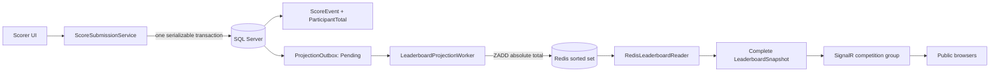

# Redis and SignalR data flow

The application separates the durable write path from the fast public read path.



## Normal score submission

1. A scorer submits participant id, signed points, reason, and an idempotency key.
2. `ScoreSubmissionService` checks that the competition is Live and the participant is active.
3. SQL Server inserts the immutable `ScoreEvent`, updates `ParticipantTotal`, and inserts one Pending `ProjectionOutbox` row in the same transaction.
4. The worker claims the outbox row with a lease. The SQL transaction is already complete before Redis is called.
5. The Redis adapter executes `ZADD leaderboard:{competitionId} {absoluteTotal} {participantId}`.
6. The reader uses Redis ordering and SQL only for participant display metadata. It calculates competition ranks with equal-score ties and returns a complete snapshot.
7. The SignalR notifier sends that snapshot to `competition:{competitionId}`. A public page replaces its in-memory snapshot and re-renders.

## Why Redis sorted sets are the point

SQL Server remains authoritative, but it is not asked to sort the public leaderboard on every browser request. Redis sorted sets are purpose-built for ordered scores:

- `ZADD` inserts or replaces one participant's absolute score.
- `ZREVRANGE` reads highest scores first.
- `ZCARD` gives the total number of ranked members.
- `ZREM` removes a deactivated participant.

The stable visual order for equal scores is applied by the Core rank mapper using participant sort order, display name, and id. The competition rank still follows competition ranking: `1, 1, 3`.

## Redis outage path

If Redis is down after SQL commits:

```text
SQL score transaction commits
        ↓
outbox remains Pending or Processing
        ↓
worker records a bounded retry delay
        ↓
public reader returns an explicit projection-unavailable state
```

When Redis returns, the worker retries the same absolute total. Replaying `ZADD` cannot double-count points. Only after projection and SignalR publication succeed does the worker mark the outbox row Published.

## Rebuild path

The admin Projection health page calls an authorized application service. It never accepts a raw Redis key from the browser. The rebuilder:

1. Reads active participants and durable totals from SQL Server.
2. Writes the full projection to `leaderboard:{competitionId}:rebuild:{operationId}`.
3. Renames the temporary key to `leaderboard:{competitionId}` atomically.

This removes stale inactive members and restores a missing projection without editing score history.

## Learning checkpoints

- Stop Redis and submit a score: SQL durability and the outbox become visible.
- Start Redis again: the worker's retry and absolute projection become visible.
- Run `ZREVRANGE ... WITHSCORES`: observe participant ids and absolute totals.
- Open two public pages: a SignalR group carries the same replacement snapshot to both.
- Submit the same idempotency key twice through the service tests: the second request replays the original event instead of incrementing again.
